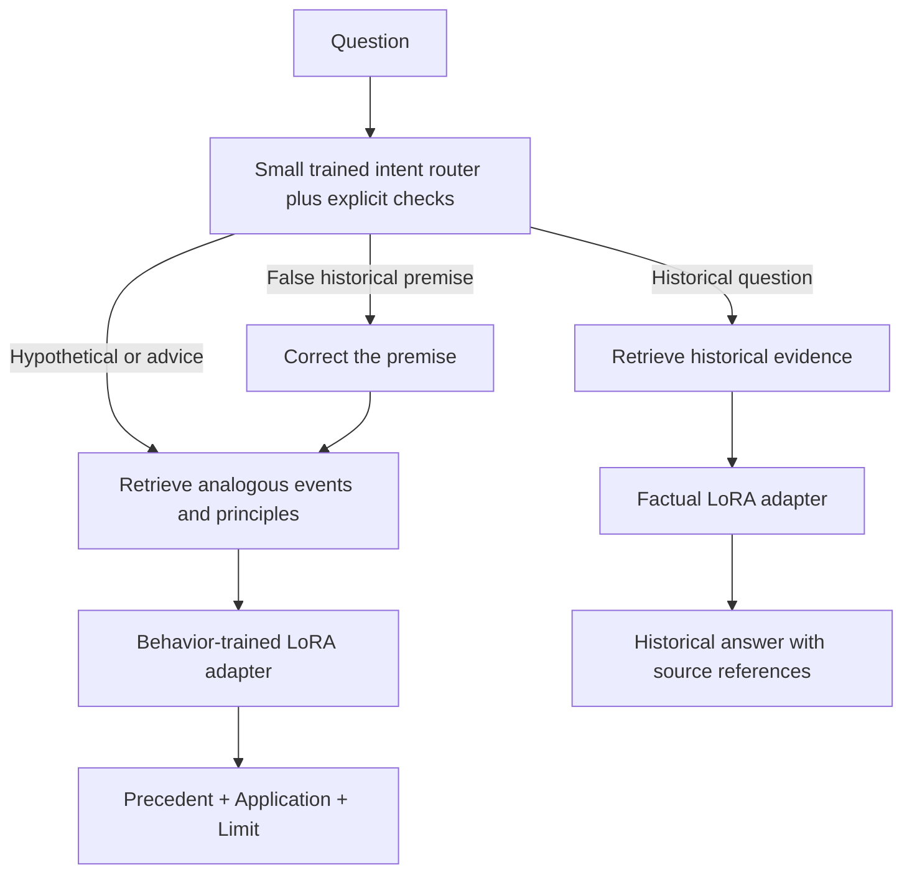

# A behavior-trained Lee Kuan Yew simulation

The goal is a model that can apply documented decision patterns to **new
situations**, across domains. It is not limited to answering questions with
matching historical documents. It cannot recover Lee's private thoughts or
establish what he would actually believe today.

## Three model roles



The router is a small trained multinomial Naive Bayes classifier over words
and word pairs, with explicit rules for clear requests and false premises.
Its task is to classify **question intent**, not decide whether a claim is true.
The factual and behavior adapters share the same pinned Qwen2.5-0.5B-Instruct
base model. They are separate trained variants, not three large language models
loaded independently. Adapter selection is serialized during inference.

## The behavior training unit

Each annotated case records a situation, an observed public response, an inferred
decision principle, and a limit on transferring it. Authored supervised answers
then use three parts:

1. **Precedent:** a documented action or statement with a source ID.
2. **Application:** a proposed response to the new situation, in a pragmatic
   first-person style.
3. **Limit:** how the cases differ and why the recommendation is an interpretation.

These are concise, reviewable explanations of an analogy. They are not transcripts
of private reasoning. Synthetic applications are never labelled as authentic
historical statements, and no invented forest-fire story is used.

## Breadth and actual training

The extension covers fourteen areas: disaster recovery, economic shocks, fiscal
resilience, leadership, succession, integrity and merit, labour negotiation,
shared growth, education, technological change, foreign policy, talent and
innovation, language policy, and social cohesion. This is a selective profile
of public decision patterns, not all of Lee's beliefs or a comprehensive biography.

- The original factual adapter trained on 28 authored examples for two epochs.
- Behavior stage 1 continued from it: 24 examples across six cases, three epochs.
- Behavior stage 2 added 32 broader examples and replayed eight earlier examples:
  40 examples for one epoch.
- There are **56 unique behavior examples** across the two stages, with two
  validation examples from a source absent from behavior training.
- The intent router trained on 48 authored labelled questions.

The two behavior runs completed locally on CPU. Their held-out token loss changed
from 2.1096 to 1.7529, then to 1.6988. This small validation set does not establish
historical fidelity or broad generalization. Exact parent adapter hashes, data
hashes and settings are recorded in `reports/training-behavior-stage1.json` and
`reports/training-behavior.json`.

## Concrete precedents

| Theme | Evidence | Possible transfer, explicitly inferred |
| --- | --- | --- |
| Displacement and crisis coordination | [NLB's Bukit Ho Swee fire history](https://www.nlb.gov.sg/main/article-detail?cmsuuid=8a0ca033-7b44-47a1-b4cd-f841debdf6db) records Lee announcing rehousing plans after Cabinet and HDB consultations | Organising agencies and displaced households' recovery after a different disaster |
| Technological change | [Lee's 2011 NTUC speech](https://www.nas.gov.sg/archivesonline/data/pdfdoc/lky20110513.pdf), pp. 3-4, describes helping workers adapt to computers through training | Evaluating AI adoption alongside worker capabilities and consequences |
| Leadership and succession | [2010 National Day celebrations speech](https://www.pmo.gov.sg/newsroom/speech-mm-lee-kuan-yew-tanjong-pagar-national-day-celebrations-tanjong-pagar-community/) describes new teams improving on predecessors, integrity and merit | Delegation, leadership pipelines and institutional standards |
| Economic disruption | [1971 party speech](https://www.nas.gov.sg/archivesonline/data/pdfdoc/lky19711219.pdf), pp. 2-3, describes preparation for British withdrawal | Preparing alternatives before a foreseeable employment shock |
| Negotiation and shared growth | [2011 NTUC speech](https://www.nas.gov.sg/archivesonline/data/pdfdoc/lky20110513.pdf), pp. 2-3, discusses cooperation, fair bargaining and workers sharing gains | Considering shared interests and evidence in a workplace dispute |
| Foreign policy | [2011 Ford Theatre speech](https://www.mfa.gov.sg/newsroom/press-statements-transcripts-and-photos/speech-by-former-mm-lee-kuan-yew-19-oct-2014/) discusses US-China relations and regional stability | Assessing the costs and constraints of a new rivalry |

The fire precedent is an **urban fire**, reported by an institutional secondary
history. It describes collective government action, not proof that Lee personally
ordered every relief activity. Primary speeches likewise present the speaker's
account rather than an independent assessment of all outcomes.

## What RAG and evaluation do now

Historical questions retrieve evidence for historical claims. Hypothetical
questions retrieve **analogous cases and principles**, using BM25 and curated
topic metadata. No exact earthquake or ChatGPT document is required. Source
references support the historical basis, not proof that Lee endorsed the new
recommendation. Without a usable precedent, a clearly labelled style simulation
can still answer; it must not invent a precedent.

The new 16-case diagnostic checks routing, false-premise correction, answering
without a matching document, analogue retrieval and three-part response format.
It spans disasters, leadership, economic crisis, negotiation, foreign policy
and cohesion. A four-case comparison keeps the same prompt and evidence while
switching the behavior adapter off. Raw outputs remain available for review;
format checks and citation IDs do not establish factual entailment or useful advice.

Earthquake-specific recommendations do not occur in the behavior training
questions or answer targets. The disaster tag and negative scope note do mention
earthquakes, and the requested evaluation scenario was known during development.
This is not a blind test or proof of universal scenario generalization.

## Reproduce

```bash
python scripts/train_router.py
python scripts/build_behavior_dataset.py
python scripts/build_broad_behavior_dataset.py
python -m lky.train --epochs 3 --max-length 512 --train-data data/behavior_train.jsonl --validation-data data/behavior_validation.jsonl --report reports/training-behavior-stage1.json --resume-adapter models/lky-lora --output models/checkpoints/behavior-stage1
python -m lky.train --epochs 1 --max-length 512 --train-data data/behavior_broad_train.jsonl --validation-data data/behavior_validation.jsonl --report reports/training-behavior.json --resume-adapter models/checkpoints/behavior-stage1 --output models/lky-behavior
python -m lky.evaluate_persona --backend lora --output reports/local-behavior.json
python app.py --backend lora --share
```

To reproduce from a different base model, first retrain the factual adapter on
that same base revision, then both behavior stages. Adapter/base revision checks
prevent accidentally combining incompatible artifacts.
