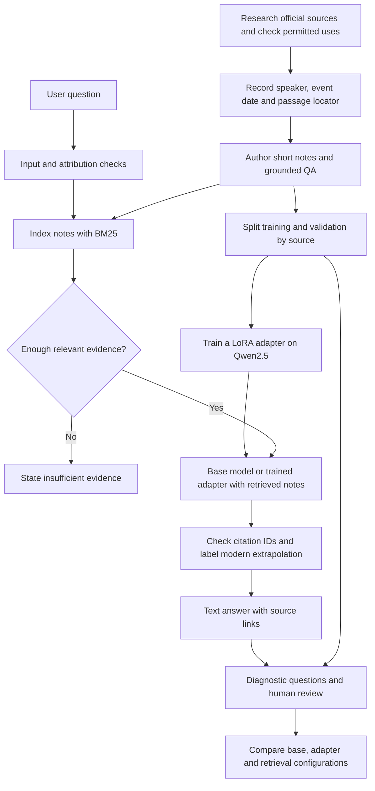

# Research → dataset → model → RAG → evaluation → text chat



## 1. Research and prepare data

Start with Lee's own words in official archives, distinguish event dates from
webpage migration dates, and keep memoirs separate until permitted use has
been established. The published starter contains original research notes and
authored QA, not copies of complete source documents.

```bash
python scripts/build_dataset.py
python scripts/validate_data.py
```

The manifest records hashes. Source-group separation reduces speech leakage
between training and validation. It cannot remove model pretraining exposure
or make a development benchmark independent.

## 2. Establish a baseline before training

Use the unchanged base model with the same questions and RAG notes. Keep an
explicit dependency-free notes backend for checking the retrieval pipeline.
The notes backend is not presented as an LLM.

```bash
python -m lky.evaluate --backend notes --output reports/local-notes.json
python -m lky.evaluate --backend base --output reports/local-base-rag.json
```

## 3. Fine-tune an open-weight model

The reproducible small-model choice is
[Qwen2.5-0.5B-Instruct](https://huggingface.co/Qwen/Qwen2.5-0.5B-Instruct),
with Apache-2.0 weights. This size is feasible on the available CPU; its answer
quality is limited. An optional 1.5B Colab experiment is a separate run, not a
result claimed for the shipped adapter.

Only LoRA weights for attention query/value projections are trained. Rank 8,
alpha 16, dropout 0.05, learning rate 0.0002, micro-batch size 1, accumulation 4,
two epochs and seed 42 are recorded. Prompt tokens receive label `-100`; only
assistant answer tokens contribute to loss. The trainer fails if a sample
exceeds the maximum length instead of silently truncating the answer.

```bash
python -m lky.train --epochs 2
```

Training validation loss is measured on S07 before and after training. Training
and validation loss are useful diagnostics, not measures of historical accuracy.
The base model commit, data hashes and training settings travel with the adapter.

## 4. Retrieve evidence at answer time

The starter index has sixteen atomic English notes, so BM25 is a practical,
inspectable baseline. It ranks word matches and returns up to three notes.
A minimum score of 1.0 and a cutoff at 40% of the best score discard weak
matches. These are development heuristics, not calibrated confidence probabilities.

The prompt asks for a concise, pragmatic reconstruction, sourced historical
claims, no invented memories or quotations, and explicit uncertainty. Each
reply carries the simulation disclosure. Modern applications receive an
extrapolation label.

The application checks whether cited note IDs exist in the retrieved set.
Missing or invalid IDs trigger a clearly labelled note-summary fallback.
The raw model answer remains in diagnostic reports. This check cannot determine
whether the claim is actually supported by the note.

The public interface accepts questions only; arbitrary uploaded webpages and
documents are not ingested. Simple injection patterns are blocked, but there
is no claim of comprehensive adversarial protection.

## 5. Evaluate the components and their combination

```bash
python -m lky.evaluate --backend base --output reports/local-base-rag.json
python -m lky.evaluate --backend lora --output reports/local-lora-rag.json
python -m lky.evaluate --backend base --no-rag --output reports/local-base-no-rag.json
python -m lky.evaluate --backend lora --no-rag --output reports/local-lora-no-rag.json
```

These comparisons isolate the adapter and retrieval under the recorded policy.
No-RAG retains the instruction to rely only on supplied evidence; it measures
the effect of removing evidence under that policy, not unconstrained model
knowledge. Examine raw generations as well as final user-facing answers.

Use a held-out human-authored set for a stronger follow-up study and ask reviewers
to rate claim support, historical framing, useful uncertainty, pragmatic style
and overall usefulness. Persona similarity must not reward false certainty or
fabricated first-person experiences.

## 6. Publish reviewable artifacts and provide chat links

Publish code, notes, source register, manifests, a small adapter, run metadata,
raw diagnostic results, chat examples, a model card and the Colab notebook.
Keep internal research, credentials, base-model weights and private originals
outside the public Git tree.

The permanent review links are the repository and `docs/CHAT_EXAMPLES.md`.
Gradio can create a temporary public chat URL with `--share`, including from
Colab. Always distinguish that temporary URL from permanent hosting.

## What RAG adds here

- Supplies dated historical evidence that is not reliably stored in model weights.
- Lets a reader follow the answer back to an official source.
- Allows evidence corrections and additions without retraining the model.
- Enables grounded responses from sources excluded from fine-tuning.
- Provides a basis for abstaining when the corpus does not answer a question.

RAG does not establish that Lee would agree with a modern extrapolation, resolve
source bias, or guarantee that an LLM correctly uses the evidence.

## What evaluation adds here

- Separates retrieval failure from generation failure.
- Measures whether the adapter helps or harms the same questions.
- Exposes fabricated attribution, missing citations and unsupported answers.
- Prevents a fallback from being mistaken for successful model generation.
- Makes quality, coverage and latency tradeoffs visible before publication.

## Tools and alternatives

| Tool | Actual role in this implementation |
| --- | --- |
| Python standard library | JSONL, hashes, BM25, CLI, checks and diagnostic metrics |
| PyTorch | Training and local inference |
| Transformers | Tokenizer, chat template and causal language model |
| PEFT | LoRA adapter training, saving and loading |
| Accelerate | Dependency supporting the Hugging Face model stack |
| safetensors | Adapter weight serialization |
| Gradio | Optional text chat and temporary sharing |
| Colab notebook | Reproducible GPU workflow; its execution status is reported separately |
| GitHub CLI / Git | Public repository publication |
| GitHub Actions | Dependency-free data and grounding checks |
| Context7 | Library documentation consulted during implementation |

Flowise could replace some orchestration, but this small Python implementation
keeps retrieval and evaluation easy to inspect. LangChain and a vector database
are not required. For a larger or multilingual corpus, compare dense embeddings,
BM25/dense fusion, reranking and metadata filters. RAGAS or DeepEval can help
scale judge-based assessments, but their scores require a calibrated rubric and
human checks. They are **future options**, not tools used for the reported scores.
